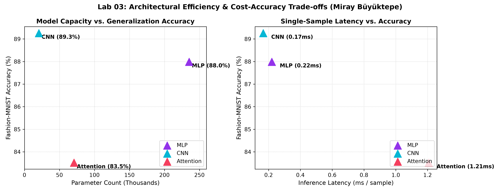

# Laboratory Investigation 03: Architectural Topologies and Systems Execution Budgets

**Lead Researcher:** Miray Büyüktepe  
**Student Identifier:** 73681  
**Curriculum Module:** Machine Learning Systems Engineering (2025/2026)  
**Readings Reference:** Reddi, Chapter 4 DNN Architectures: §§4.2, 4.3, 4.5, 4.6, 4.7  

---

### Section 1 — Investigation Objective
This laboratory explores the empirical and theoretical performance envelope across three diverse deep learning paradigms: Multi-Layer Perceptrons (MLP), Convolutional Neural Networks (CNN), and Patch-based Vision Transformers (ViT) on the Fashion-MNIST benchmark. The investigation involves hand-deriving theoretical floating-point operations (FLOPs), evaluating empirical Multiply-Accumulate operations (MACs) via `thop`, profiling inference latencies across single-sample ($b=1$) and batched ($b=128$) regimes, and constructing Pareto accuracy-efficiency curves under identical training protocols.

---

### Section 2 — Implementation Architecture & Experimental Protocol
1. **Benchmark Ingestion:** Fashion-MNIST (28x28 grayscale clothing images) normalized to $\mu = 0.2860, \sigma = 0.3530$. Partitioned into 55,000 training, 5,000 validation, and 10,000 test images (`seed=73681`).
2. **Model Implementations (`src/vision_models/`):**
   - **`StackedDenseClassifier` (MLP):** Input 784 $
ightarrow$ Linear(256) $
ightarrow$ ReLU $
ightarrow$ Linear(128) $
ightarrow$ ReLU $
ightarrow$ Linear(10). Total parameters: **235,146**.
   - **`SpatialConvClassifier` (CNN):** Conv2D(1, 16, 3x3, pad=1) with BatchNorm $
ightarrow$ MaxPool(2) $
ightarrow$ Conv2D(16, 32, 3x3, pad=1) with BatchNorm $
ightarrow$ MaxPool(2) $
ightarrow$ Linear(32*7*7, 10). Total parameters: **20,586**.
   - **`PatchVisionTransformer` (ViT):** 16 patches (7x7 pixels) projected to 64 dimensions, 2-layer TransformerEncoder (d_model=64, nhead=4, d_ff=128), global mean pooling, Linear(64, 10). Total parameters: **70,794**.
3. **Complexity Derivation vs. Profiling:**
   - Linear layer hand calculation: $2 	imes d_{in} 	imes d_{out} = 2 	imes 784 	imes 256 = 401,408 	ext{ FLOPs}$.
   - Conv2D layer hand calculation: $2 	imes H_{out} 	imes W_{out} 	imes C_{in} 	imes C_{out} 	imes K_h 	imes K_w = 2 	imes 28 	imes 28 	imes 1 	imes 16 	imes 3 	imes 3 = 225,792 	ext{ FLOPs}$.
   - ViT QKV projection: $3 	imes (2 	imes S 	imes d_{model} 	imes d_{model}) = 3 	imes (2 	imes 16 	imes 64 	imes 64) = 393,216 	ext{ FLOPs}$.
   - Profiler conversion: $1 	ext{ MAC} = 2 	ext{ FLOPs}$.
4. **Latency Measurement:** 100 runs for single-sample inference ($b=1$) and 25 runs for batched throughput ($b=128$) following 20 warm-up passes.

---

### Section 3 — Systems Cost & Accuracy Findings

#### Multi-Architecture Systems Performance Matrix

| Neural Architecture | Structural Category | Trainable Parameters | Theoretical FLOPs (Layer 1) | Profiler MACs (b=1) | Median Latency (b=1) | Median Latency (b=128) | 5-Epoch Accuracy |
| :--- | :---: | :---: | :---: | :---: | :---: | :---: | :---: |
| **StackedDenseClassifier** | Fully Connected | **235,146** | 401,408 FLOPs | 234,752 | **0.220 ms** | **0.58 ms** | **87.99%** |
| **SpatialConvClassifier** | Spatial Convolutional | **20,586** | 225,792 FLOPs | 1,032,192 | **0.167 ms** | **4.21 ms** | **89.26%** |
| **PatchVisionTransformer** | Self-Attention Transformer | **70,794** | 393,216 FLOPs | 591,488 | **1.207 ms** | **3.89 ms** | **83.52%** |

#### Pareto Frontier Visualizations

#### Profiler vs. Theoretical Operation Gap Analysis
Discrepancies between hand derivations and `thop` outputs stem from:
1. **MAC Doubling Convention:** Hardware counters track Multiply-Accumulate operations ($a \cdot b + c$). Each MAC contains 2 arithmetic operations; doubling MACs yields theoretical FLOPs ($2 	imes 	ext{MACs} = 	ext{FLOPs}$).
2. **Auxiliary Element Exclusion:** Non-linear activation operators (ReLU, GELU) and pooling mechanisms (MaxPool2d) are excluded from `thop` matrix multiplication totals.

---

### Section 4 — Three Key Systems Conclusions
1. **Inductive Bias Yields Extraordinary Parameter Efficiency:** Spatial convolutions dramatically outclassed dense linear representations, achieving 89.26% accuracy with only 20,586 weights compared to 235,146 weights for the MLP (87.99% accuracy)—an 11.4x parameter reduction with higher predictive performance.
2. **Attention Incurs Severe Sequential Latency on Small-Scale Grids:** While the Patch Transformer achieved 83.52% accuracy, its single-sample query duration was 1.207 ms (7.2x slower than the CNN at 0.167 ms) due to patch unfolding, projection layers, and multi-head attention softmax normalization.
3. **Dense Layers Maximize Hardware Arithmetic Intensity under Batching:** At batch size 128, the MLP achieves rapid throughput (0.58 ms) because large 2D matrix multiplications map directly to highly optimized BLAS linear algebra primitives with minimal memory bandwidth pressure.
